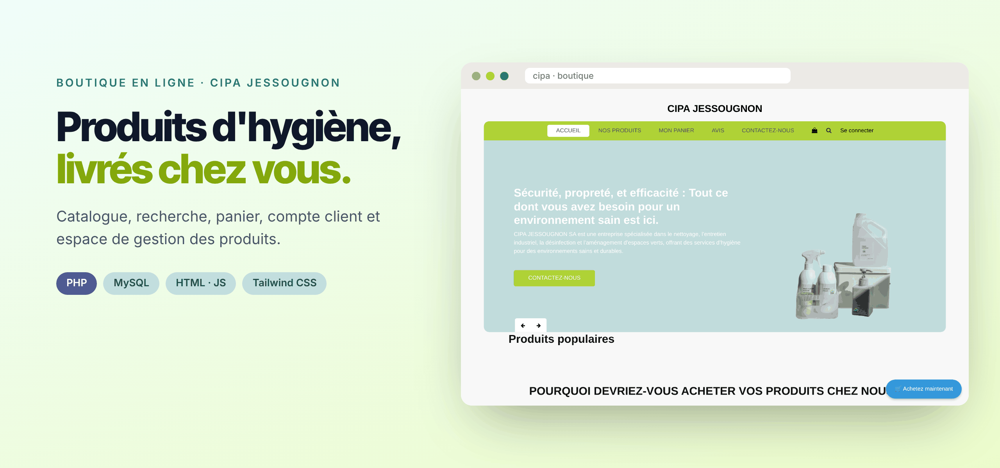

<p align="center">
  
</p>

# CIPA JESSOUGNON · Boutique en ligne

Site e-commerce de produits d'hygiène et de désinfection pour CIPA JESSOUGNON : catalogue, recherche, panier, compte client et espace de gestion des produits.

## Fonctionnalités

- Catalogue et fiches produit
- Recherche de produits
- Panier et paiement
- Inscription, connexion et compte client
- Tableau de bord pour gérer les produits et les catégories

## Stack

- **Front** : HTML, JavaScript, Tailwind CSS
- **Back** : PHP + MySQL

## Lancer le projet

1. Créer la base MySQL `dashboard_management` et ajuster les accès dans `backend/db_connect.php`.
2. Compiler le CSS :
   ```bash
   npm install
   npm run build:css
   ```
3. Servir le dossier avec PHP :
   ```bash
   php -S localhost:8000
   ```
   puis ouvrir [http://localhost:8000/src/index.html](http://localhost:8000/src/index.html).

## Structure

```
src/           pages du site (accueil, boutique, panier, compte…)
backend/       scripts PHP (connexion, recherche, produits, dashboard)
css/  js/      styles et scripts
images/        visuels produits
```
